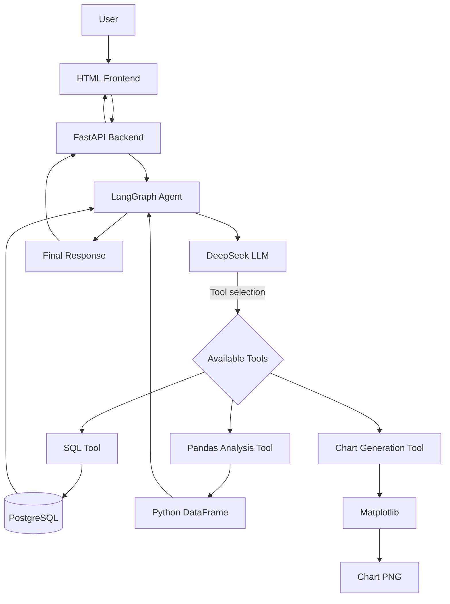

# AI Data Scientist & Analytics Agent

An AI-powered analytics application that allows users to ask business questions in natural language and receive data-driven answers from a PostgreSQL database.

The application uses LangGraph to orchestrate an LLM-powered agent that can execute SQL queries, perform Python-based analysis using Pandas, and generate visualizations using Matplotlib.

## 1. Project Overview

Business analysts often need to write SQL queries, perform calculations, and create visualizations to answer business questions.

This project simplifies that workflow by allowing users to interact with business data using natural language.

For example:

- What is the total revenue from Maharashtra?
- Which product category generates the highest profit?
- Compare revenue across different states.
- Show monthly revenue as a line chart.
- Which sub-categories contribute most to overall sales?

The agent interprets the question, selects the appropriate analytical tool, retrieves data, performs the analysis, and generates a business-oriented response.

## 2. Key Features

- Natural-language interaction with business data.
- LangGraph-based agent workflow.
- DeepSeek LLM integration.
- Dynamic SQL query generation and execution.
- PostgreSQL database connectivity.
- Pandas-based data analysis.
- Matplotlib visualizations.
- Multi-metric chart generation.
- Schema-aware query generation.
- Basic SQL safety validation.
- FastAPI backend.
- Browser-based user interface.
- Docker-based application packaging.

## 3. System Architecture



### Agent workflow

1. The user submits a business question through the frontend.
2. FastAPI receives the question.
3. LangGraph invokes the agent.
4. DeepSeek interprets the question and determines which tool is required.
5. The selected tool performs the requested operation.
6. The tool returns its result to the agent.
7. The agent generates a final response.
8. FastAPI returns the answer and, when applicable, a chart to the frontend.

## 4. Technology Stack

| Component | Technology |
|---|---|
| Programming language | Python |
| LLM | DeepSeek |
| Agent orchestration | LangGraph |
| LLM integration | LangChain |
| Backend API | FastAPI |
| Database | PostgreSQL |
| Data analysis | Pandas |
| Visualization | Matplotlib |
| Frontend | HTML, CSS, JavaScript |
| Containerization | Docker |

## 5. Database

The application uses an Indian e-commerce sales dataset.

Dataset source: [Indian E-Commerce Sales Dataset – Kaggle](https://www.kaggle.com/datasets/benroshan/ecommerce-data)

The PostgreSQL database contains three tables:

### orders

Contains order-level information.

| Column | Description |
|---|---|
| order_id | Order identifier |
| order_date | Order date |
| customer_name | Customer name |
| state | State |
| city | City |

### order_details

Contains individual order-item and financial information.

| Column | Description |
|---|---|
| id | Record identifier |
| order_id | Associated order |
| amount | Revenue amount |
| profit | Profit |
| quantity | Quantity |
| category | Product category |
| sub_category | Product sub-category |

### sales_targets

Contains monthly sales targets.

| Column | Description |
|---|---|
| month | Month |
| category | Product category |
| target | Sales target |

### Table relationship

`orders.order_id` is related to `order_details.order_id`.

The agent uses this relationship when questions require combining order information with financial data.

## 6. Project Structure

```text
ai-data-scientist-agent/
│
├── app/
│   ├── __init__.py
│   ├── main.py
│   ├── agent.py
│   ├── graph.py
│   ├── llm.py
│   ├── database.py
│   └── analytics_tools.py
│
├── frontend/
│   └── index.html
│
├── scripts/
│   ├── clean_data.py
│   ├── profile_data.py
│   └── relationship_check.py
│
├── tests/
│   ├── __init__.py
│   ├── test_agent.py
│   ├── test_database.py
│   ├── test_database_info.py
│   ├── test_deepseek.py
│   ├── test_deepseek_tools.py
│   ├── test_graph.py
│   ├── test_multi_chart.py
│   ├── test_python_tool.py
│   ├── test_sql_safety.py
│   └── test_tool_calling.py
│
├── charts/
├── data/
├── .dockerignore
├── .gitignore
├── Dockerfile
├── requirements.txt
└── README.md
```

### Important files

- `main.py`: FastAPI application and API endpoints.
- `agent.py`: Agent instructions, database context, and response handling.
- `graph.py`: LangGraph workflow and tool execution routing.
- `llm.py`: DeepSeek model configuration.
- `database.py`: PostgreSQL connectivity, schema retrieval, and SQL execution.
- `analytics_tools.py`: SQL, Pandas, and chart-generation tools.
- `index.html`: Browser-based application interface.

## 7. Local Setup

### Prerequisites

- Python 3.12
- PostgreSQL
- DeepSeek API key
- Git

### Step 1: Clone the repository

```bash
git clone https://github.com/HuzaifaZaidi/ai-data-scientist-agent.git
cd ai-data-scientist-agent
```

### Step 2: Create a virtual environment

```bash
python -m venv .venv
```

Activate it on Windows:

```powershell
.venv\Scripts\Activate.ps1
```

### Step 3: Install dependencies

```bash
pip install -r requirements.txt
```

### Step 4: Configure PostgreSQL

Create a PostgreSQL database named:

```text
ecommerce_db
```

Import the dataset tables:

- orders
- order_details
- sales_targets

Configure a PostgreSQL user with read-only access to the required tables.

### Step 5: Configure environment variables

Create a `.env` file in the project root:

```env
DB_HOST=localhost
DB_PORT=5432
DB_NAME=ecommerce_db
DB_USER=analytics_agent
DB_PASSWORD=your_database_password

DEEPSEEK_API_KEY=your_deepseek_api_key
```

Replace the placeholder values with your actual credentials.

Never commit `.env` or expose API keys and database passwords publicly.

### Step 6: Start the application

```bash
python -m uvicorn app.main:app --reload
```

Open the application:

http://127.0.0.1:8000

## 8. Docker Setup

The application can also be packaged and run using Docker.

### Prerequisites

- Docker Desktop
- Running PostgreSQL instance
- DeepSeek API key

### Step 1: Configure Docker environment variables

Create a `.env.docker` file:

```env
DB_HOST=host.docker.internal
DB_PORT=5432
DB_NAME=ecommerce_db
DB_USER=analytics_agent
DB_PASSWORD=your_database_password

DEEPSEEK_API_KEY=your_deepseek_api_key
```

Use your actual credentials. Keep this file out of Git.

### Step 2: Build the Docker image

```bash
docker build -t ai-data-scientist-agent .
```

### Step 3: Run the container

```bash
docker run -d \
  --name ai-data-scientist-agent \
  -p 8000:8000 \
  --env-file .env.docker \
  ai-data-scientist-agent
```

### Step 4: Access the application

http://localhost:8000

### Useful Docker commands

View running containers:

```bash
docker ps
```

View application logs:

```bash
docker logs ai-data-scientist-agent
```

Stop the container:

```bash
docker stop ai-data-scientist-agent
```

Remove the container:

```bash
docker rm ai-data-scientist-agent
```

## 9. Example Questions

Try asking the following questions:

**Revenue analysis**
- What is the total revenue by state?
- Which state generates the highest revenue?
- What is the monthly revenue trend?

**Profitability analysis**
- Which product category generates the highest profit?
- Compare profit across product categories.
- Which sub-category has the lowest profit?

**Visual analytics**
- Show monthly revenue as a line chart.
- Create a bar chart comparing revenue by state.
- Compare revenue and profit across categories.

## 10. Testing

The project includes tests for database connectivity, schema retrieval, SQL safety, agent execution, LLM integration, tool calling, and chart generation.

Run individual tests from the project root:

```bash
python -m tests.test_database
python -m tests.test_database_info
python -m tests.test_sql_safety
python -m tests.test_graph
python -m tests.test_multi_chart
```

Tests that exercise DeepSeek integration require a valid API key and may incur API usage.

## 11. Current Limitations

- The application works with the configured e-commerce database schema.
- The dataset is historical and relatively small.
- Currency metadata is not defined in the dataset; monetary values should therefore be interpreted in dataset units.
- The current SQL validator uses conservative SELECT-only checks and does not support every valid SQL query pattern, including CTEs.
- The application requires a working PostgreSQL connection and DeepSeek API key.
- The agent provides descriptive analysis; its findings should not automatically be interpreted as causal explanations.

## 12. Future Improvements

Potential extensions include:

- Support for additional databases and datasets.
- More advanced analytical and statistical tools.
- Query-result caching.
- Improved SQL validation and query governance.
- User authentication and role-based access.
- Conversation history and analytical memory.
- Cloud deployment and production monitoring.

---

**Author:** Huzaifa Ahmed Zaidi

**GitHub:** [HuzaifaZaidi](https://github.com/HuzaifaZaidi)
